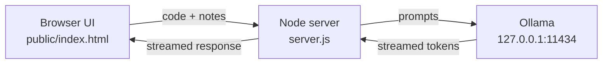
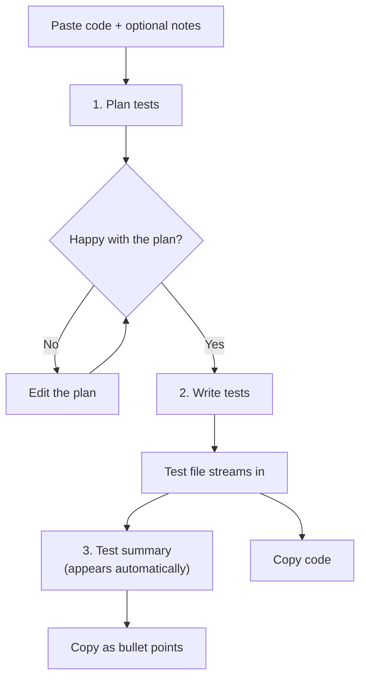

<div align="center">

# 🧪 Test Agent

**A local, offline AI agent with a web interface that writes tests for you.**
Paste a React component or an Express route. It plans the tests, writes them, and gives you a written summary of what was covered.

[](https://nodejs.org/)
[](https://ollama.com)
[](https://vitest.dev/)
[](#project-structure)
[](https://claude.ai)

</div>

---

## Table of Contents

- [Overview](#overview)
- [Features](#features)
- [How It Works](#how-it-works)
- [Requirements](#requirements)
- [Setup](#setup)
- [How to Use It](#how-to-use-it)
- [About the Summary](#about-the-summary)
- [Project Structure](#project-structure)
- [Customizing the Agent](#customizing-the-agent)
- [Tips for Better Results](#tips-for-better-results)
- [Troubleshooting](#troubleshooting)
- [Made With Claude](#made-with-claude)

---

## Overview

Test Agent turns a pasted piece of code into a test file in three stages: it **plans** the tests, **writes** them, then gives a **written summary** of what was covered.

It only generates tests. It never runs them and never touches your code.

| Stack | What it generates |
| --- | --- |
| **React** | Vitest + React Testing Library |
| **Express / PostgreSQL** | Vitest + Supertest (database layer mocked) |

Everything runs on your own machine through [Ollama](https://ollama.com). After the one-time model download, no internet is needed and no code leaves your computer.

## Features

- **Plan first, then write.** The plan streams in under *Happy paths*, *Edge cases*, *Error cases* and *What to mock*. You can edit it before any test code is written.
- **Plan-driven generation.** The test file follows whatever is in the plan box, so fixing the plan is the cheapest way to fix the output.
- **Streaming output.** Both the plan and the test file stream in live, and a **Stop** button cancels whatever is currently generating.
- **Clean copy.** One click copies just the code, without the markdown fences.
- **Automatic test summary.** Exact counts, a category breakdown, and a bullet-point version you can copy.
- **Fully local.** Powered by Ollama, so it works offline and your code stays on your machine.
- **Zero dependencies.** Nothing to `npm install`. It's a tiny Node server and one HTML page.
- **Choose your model.** Pick any installed Ollama model from a dropdown.
- **Customizable prompts.** Testing conventions and prompts live in one file, `server.js`.

## How It Works





The server makes three kinds of model calls, one per stage: **plan**, **write tests**, and **classify tests** for the summary.

## Requirements

- **Node.js 18 or newer** (run `node -v` to check)
- **[Ollama](https://ollama.com)**, installed and running
- **A coding model.** Pick by RAM:

  | RAM | Recommended model |
  | --- | --- |
  | 8 GB | `qwen2.5-coder:7b` |
  | 16 GB or more | `qwen2.5-coder:14b` |

## Setup

1. **Install Ollama and open it.** A llama icon appears in the menu bar.
2. **Download a model once** (this needs internet):

   ```bash
   ollama pull qwen2.5-coder:7b
   ollama list    # confirm it appears
   ```

3. **Start the agent** from inside the project folder:

   ```bash
   cd test-agent
   npm start
   ```

4. **Open** [http://localhost:3000](http://localhost:3000)

There is nothing to `npm install`, because the project has no dependencies. Keep the terminal open while you use the agent, and press `Ctrl+C` to stop it.

## How to Use It

1. Choose **React component** or **Express route** at the top.
2. Pick a model from the dropdown.
3. Paste the code you want to test into **Code to test**.
4. Optionally add notes, such as the file path, what to mock, or what matters most.
5. Click **Plan tests**. The plan streams in under *Happy paths*, *Edge cases*, *Error cases* and *What to mock*.
6. Edit the plan if you disagree with anything. The tests follow whatever is in the plan box.
7. Click **Write tests**. The full test file streams into **Test file**.
8. Click **Copy** to copy just the code, without the markdown fences.
9. Read the **Test summary**. It appears automatically and can be copied as bullet points with its own **Copy** button.

**Stop** cancels whatever is currently generating.

## About the Summary

| Part of the summary | How it's produced | How much to trust it |
| --- | --- | --- |
| Total test count | Counted directly from the generated code | Exact |
| Number of `describe` blocks | Counted directly from the generated code | Exact |
| Category breakdown (input validation, output validation, error handling, and so on) | Decided by the model | Check it before relying on it. Smaller models can mislabel a test |

Counting rules:

- Tests written with `it.skip` are **not** counted.
- `it.each` counts as **one** test.

## Project Structure

```text
test-agent/
├── server.js        # tiny Node server: serves the UI and talks to Ollama
├── package.json
└── public/
    └── index.html   # the interface (add styles.css / script.js here if you split it)
```

> **Splitting the page?** If you move styles and scripts into `styles.css` and `script.js`, put them inside `public/` and make sure `server.js` serves any file in that folder, not only `index.html`. Otherwise the browser gets a 404 for them.

## Customizing the Agent

All the prompting lives in `server.js`:

| Piece | What it controls |
| --- | --- |
| `RULES` | The testing conventions for each stack (query by role, mock the database, cover 500 errors, and so on). Edit these to match your own style, for example "always mock `db.js`" |
| `buildMessages` | The prompts for the three stages: plan, write tests, and classify tests for the summary |
| Generation options | The model runs with `temperature: 0.2` and `num_ctx: 8192`. Raise `num_ctx` if you paste very long files, at the cost of more memory |

### Environment variables

| Variable | Default | Purpose |
| --- | --- | --- |
| `PORT` | `3000` | Port for the web UI |
| `OLLAMA_URL` | `http://127.0.0.1:11434` | Where Ollama is running |

Example:

```bash
PORT=4000 OLLAMA_URL=http://127.0.0.1:11434 npm start
```

## Tips for Better Results

- Paste **one component or one route at a time**.
- Use the notes field to give the **file path**, so the generated imports are correct.
- **Review and edit the plan** before writing tests. It is the cheapest place to fix mistakes.
- **Always read the generated tests and run them yourself.** Local models make mistakes, especially with mocks and import paths.

## Troubleshooting

| Problem | Fix |
| --- | --- |
| Model dropdown is empty or shows an error | Ollama is not running or no model is installed. Open the Ollama app and run `ollama pull qwen2.5-coder:7b`. |
| "Could not reach Ollama" | Start it with `ollama serve`, or check `OLLAMA_URL`. |
| UI looks outdated after an update | Restart `npm start`, then hard refresh with `Cmd+Shift+R`. |
| CSS or JS not loading after splitting files | Make sure the files are in `public/` and `server.js` serves them, then restart the server. |
| Generation is slow or the Mac gets sluggish | Use the smaller 7B model and close other heavy apps. |
| Tests don't match your project | Add notes about your file paths and mocks, or tweak `RULES` in `server.js`. |

## Made With Claude

This project was made with [Claude](https://claude.ai) (Claude.ai), Anthropic's AI assistant. The generated tests are a starting point: local models can get mocks and import paths wrong, so review them before relying on them.
